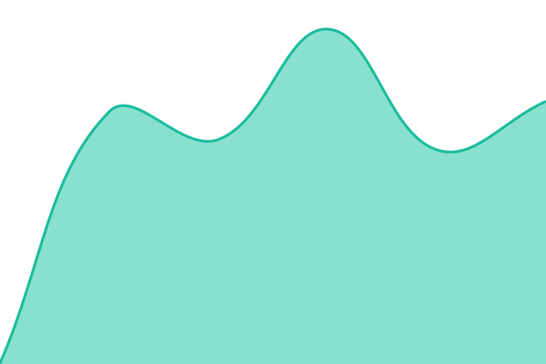
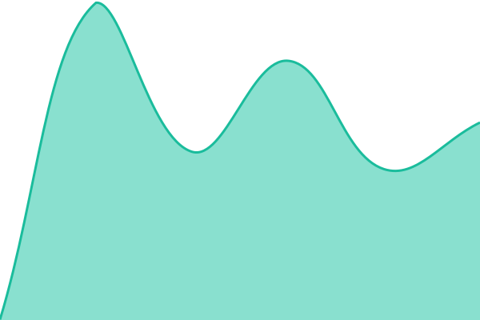
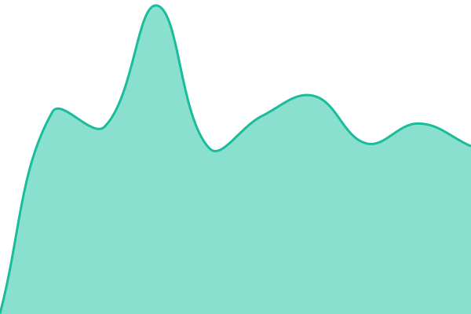
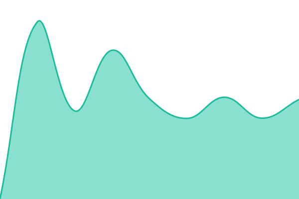

# [📈 Stato attuale](https://robertostefana.github.io/bresciapedala-status): <!--live status--> **🟧 Partial outage**

This repository contains the open-source uptime monitor and status page for [Roberto Stefana](https://robertostefana.github.io/bresciapedala-status), powered by [Upptime](https://github.com/upptime/upptime).

With [Upptime](https://upptime.js.org), you can get your own unlimited and free uptime monitor and status page, powered entirely by a GitHub repository. We use [Issues](https://github.com/robertostefana/bresciapedala-status/issues) as incident reports, [Actions](https://github.com/robertostefana/bresciapedala-status/actions) as uptime monitors, and [Pages](https://robertostefana.github.io/bresciapedala-status) for the status page.

## [📈 Live Status](https://demo.upptime.js.org): <!--live status--> **🟧 Partial outage**

<!--start: status pages-->
<!-- This summary is generated by Upptime (https://github.com/upptime/upptime) -->
<!-- Do not edit this manually, your changes will be overwritten -->
<!-- prettier-ignore -->
| URL | Status | History | Response Time | Uptime |
| --- | ------ | ------- | ------------- | ------ |
|  [Sito](https://bresciapedala.duckdns.org/) | Funziona | [sito.yml](https://github.com/robertostefana/bresciapedala-status/commits/HEAD/history/sito.yml) | 

 1273ms
     
 | 

<a href="https://robertostefana.github.io/bresciapedala-status/history/sito">100.00%</a>
    

|  [API](https://bresciapedala.duckdns.org/api/health) | Funziona | [api.yml](https://github.com/robertostefana/bresciapedala-status/commits/HEAD/history/api.yml) | 

 393ms
     
 | 

<a href="https://robertostefana.github.io/bresciapedala-status/history/api">100.00%</a>
    

|  [Database](https://bresciapedala.duckdns.org/api/status/db) | Funziona | [database.yml](https://github.com/robertostefana/bresciapedala-status/commits/HEAD/history/database.yml) | 

 531ms
     
 | 

<a href="https://robertostefana.github.io/bresciapedala-status/history/database">100.00%</a>
    

|  [Mappa](https://bresciapedala.duckdns.org/api/status/tiles) | Funziona | [mappa.yml](https://github.com/robertostefana/bresciapedala-status/commits/HEAD/history/mappa.yml) | 

 558ms
     
 | 

<a href="https://robertostefana.github.io/bresciapedala-status/history/mappa">100.00%</a>
    

|  [Dati OSM](https://bresciapedala.duckdns.org/api/status/overpass) | Non funziona | [dati-osm.yml](https://github.com/robertostefana/bresciapedala-status/commits/HEAD/history/dati-osm.yml) | 

 378ms
     
 | 

<a href="https://robertostefana.github.io/bresciapedala-status/history/dati-osm">0.17%</a>
    

|  [Ricerca luoghi](https://bresciapedala.duckdns.org/api/status/geocoder) | Funziona | [ricerca-luoghi.yml](https://github.com/robertostefana/bresciapedala-status/commits/HEAD/history/ricerca-luoghi.yml) | 

 614ms
     
 | 

<a href="https://robertostefana.github.io/bresciapedala-status/history/ricerca-luoghi">100.00%</a>
    

|  [Email](https://bresciapedala.duckdns.org/api/status/mail) | Funziona | [email.yml](https://github.com/robertostefana/bresciapedala-status/commits/HEAD/history/email.yml) | 

 378ms
     
 | 

<a href="https://robertostefana.github.io/bresciapedala-status/history/email">100.00%</a>
    

|  [Backup](https://bresciapedala.duckdns.org/api/status/backup) | Funziona | [backup.yml](https://github.com/robertostefana/bresciapedala-status/commits/HEAD/history/backup.yml) | 

 383ms
     
 | 

<a href="https://robertostefana.github.io/bresciapedala-status/history/backup">100.00%</a>
    

<!--end: status pages-->

[**Visit our status website →**](https://robertostefana.github.io/bresciapedala-status)

## 📄 License

- Powered by: [Upptime](https://github.com/upptime/upptime)
- Code: [MIT](./LICENSE) © [Anand Chowdhary](https://anandchowdhary.com)
- Data in the `./history` directory: [Open Database License](https://opendatacommons.org/licenses/odbl/1-0/)
